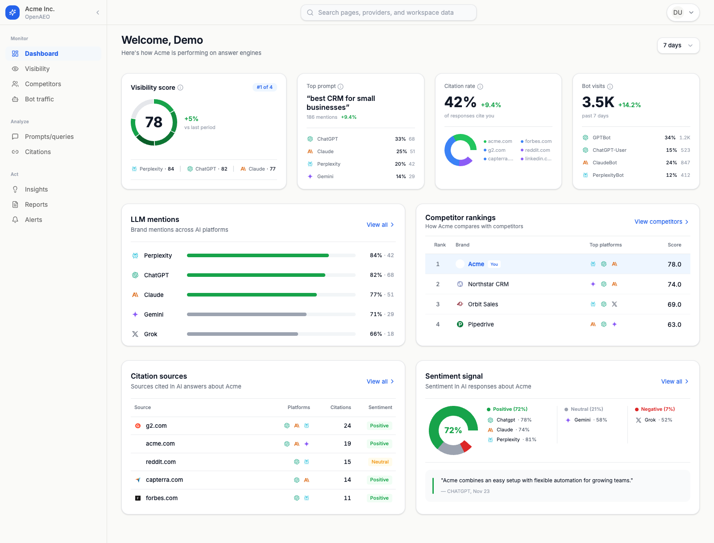
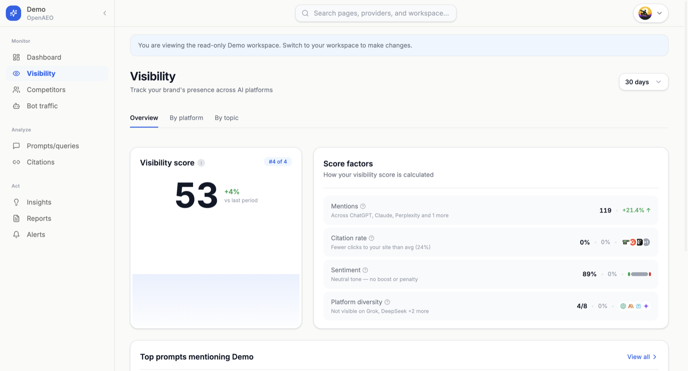
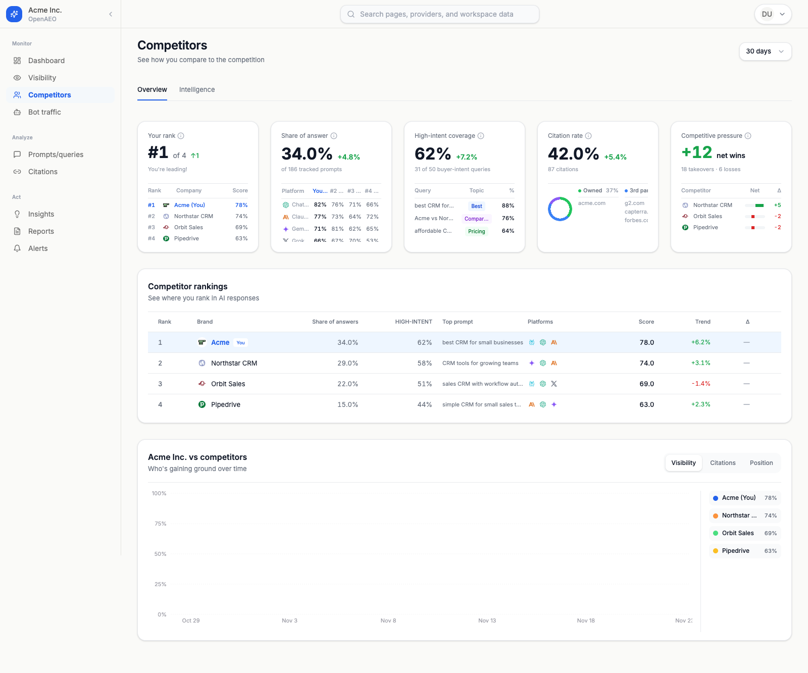
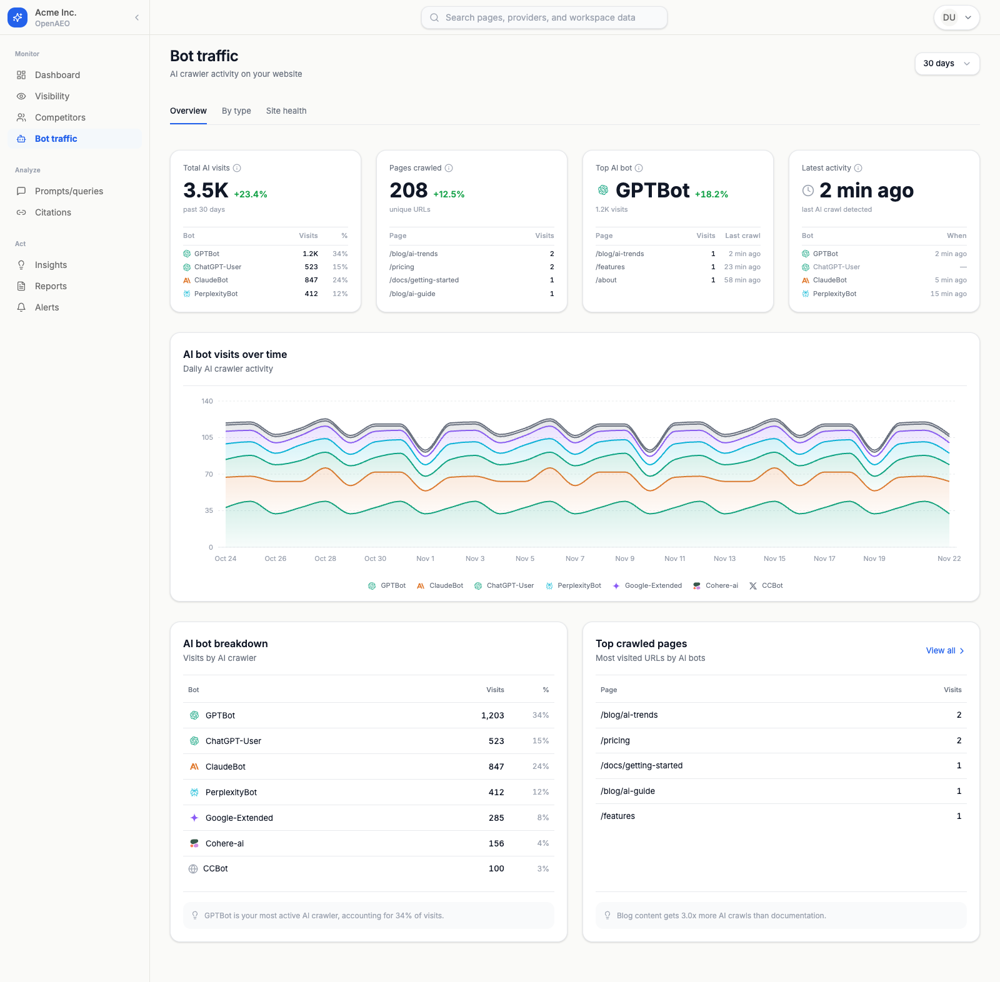
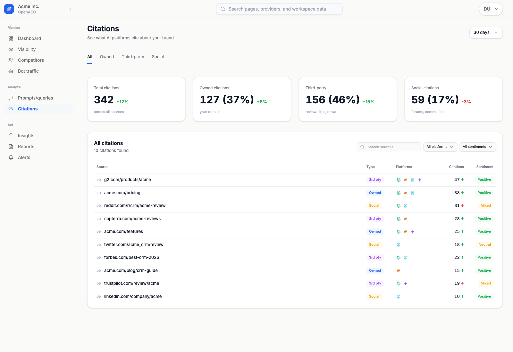

# OpenAEO

OpenAEO is open-source software for tracking how brands appear in AI-generated answers. Teams can run prompt analyses across supported AI platforms, inspect answer citations, and review related competitor, site-health, and bot-traffic data. You can run your own installation with accounts and infrastructure that you control.

## What it includes

- Prompt and topic organization for recurring visibility checks
- Workspace-scoped records with PostgreSQL row-level security
- AI response and citation collection through provider APIs
- Optional Puppeteer fallback for platform web pages
- Competitor monitoring, site diagnostics, and AI crawler visit reporting
- Clerk sign-in with per-workspace data isolation

## Screenshots

After signing in, open the workspace switcher and choose Demo to explore the sample data. Demo is read-only and separate from your working workspace.

### Dashboard



See visibility score, top prompts, citation rate, bot visits, competitor rankings, citation sources, and sentiment in one view.

### Visibility



Break down visibility by mentions, citation rate, sentiment, and platform diversity, with the prompts driving the score below.

### Competitors



Compare rank, answer share, high intent coverage, citation rate, and score trends across competing brands.

### Bot traffic



Track crawler totals, recent activity, daily traffic, bot mix, and the pages AI bots visit.

### Citations



Filter third-party sources by platform and sentiment, then compare citation counts, trends, and sentiment.

## Stack

- React, TypeScript, and Vite for the web client
- Node.js and Express for the API
- Prisma and PostgreSQL for persistence
- Clerk for authentication
- Puppeteer for optional browser-based collection

## Source layout

- `api/data/` defines the workspace data contract and Prisma-backed repository
- `api/services/site-intelligence/` reads public brand websites for profile data
- `api/services/ai/` handles topic, prompt, and competitor research through configured model APIs
- `api/services/analysis/` coordinates workspace-scoped analysis runs
- `api/services/platforms/` collects answers from configured model APIs, with optional browser fallback
- `client/src/` contains the OpenAEO web application

The UI primitives retained from shadcn/ui are listed with their license in [`THIRD_PARTY_NOTICES.md`](THIRD_PARTY_NOTICES.md).

## Run locally

### Requirements

- Node.js 20 or newer
- PostgreSQL 15 or newer
- A Clerk application (a development instance is enough for local use)

### Install and configure

```bash
git clone https://github.com/blvvck/OpenAEO.git
cd OpenAEO
npm install
cp .env.example .env.local
```

Set the keys for your own Clerk application in `.env.local`. Clerk's development instance is enough for local use and provides shared OAuth credentials for testing social sign-in. You do not need Google, GitHub, or Microsoft developer accounts unless you choose to configure your own credentials for those providers. Add whichever model-provider credentials you want OpenAEO to use. The client key starts with `VITE_`; the Clerk secret key stays server-side.

### Database

Supabase is the recommended managed PostgreSQL option. Other PostgreSQL providers can also be used.

For Supabase, create a project and run this in its SQL Editor to create a restricted role for the running app:

```sql
CREATE ROLE openaeo_app LOGIN PASSWORD 'replace-with-a-long-random-password'
  NOSUPERUSER NOCREATEDB NOCREATEROLE NOINHERIT NOREPLICATION NOBYPASSRLS;
GRANT USAGE ON SCHEMA public TO openaeo_app;
GRANT SELECT, INSERT, UPDATE, DELETE ON ALL TABLES IN SCHEMA public TO openaeo_app;
GRANT USAGE, SELECT, UPDATE ON ALL SEQUENCES IN SCHEMA public TO openaeo_app;
ALTER DEFAULT PRIVILEGES FOR ROLE postgres IN SCHEMA public
  GRANT SELECT, INSERT, UPDATE, DELETE ON TABLES TO openaeo_app;
ALTER DEFAULT PRIVILEGES FOR ROLE postgres IN SCHEMA public
  GRANT USAGE, SELECT, UPDATE ON SEQUENCES TO openaeo_app;
```

Set these database variables in `.env.local`:

- `DATABASE_URL`: the direct Supabase connection for migrations. If your network cannot reach its IPv6 endpoint, use the Session pooler connection.
- `APP_DATABASE_URL`: the Session pooler connection using the `openaeo_app` role. Do not use the transaction pooler.

Copy the host, port, and username from Supabase's **Connect** dialog. URL-encode special characters in passwords. For the Node PostgreSQL driver, use `sslmode=require&uselibpqcompat=true` on the Session pooler URL so SSL stays encrypted without requiring an unconfigured CA certificate. To verify the server certificate as well, download the Supabase CA certificate and configure `sslmode=verify-full` with its path. The runtime role must not own the tables or have superuser or `BYPASSRLS` privileges; the app checks this when it starts.

For local PostgreSQL, use the same two-role arrangement: a migration account that owns schema changes and an `openaeo_app` runtime account with table and sequence access but without row-security bypass privileges.

Apply the committed Prisma migrations, then start the app:

```bash
npm run db:generate
npm run db:migrate
npm run db:seed
npm run dev
```

Open `http://localhost:3000`. `npm run db:seed` populates the platform catalog used by collection; it does not create user or customer records. A fresh installation has no seeded users, workspaces, or customer data. Each person who signs up gets a workspace associated with their own Clerk user, and the app provisions a separate read-only Demo workspace with sample analytics on that user's first authenticated request, so no manual demo seeding step is needed. For a production deployment, use your own Clerk production instance and keys; each social provider you enable requires its own provider credentials. See Clerk's guides for [Google](https://clerk.com/docs/guides/configure/auth-strategies/social-connections/google), [GitHub](https://clerk.com/docs/guides/configure/auth-strategies/social-connections/github), and [Microsoft](https://clerk.com/docs/guides/configure/auth-strategies/social-connections/microsoft).

## Configuration

The full variable list is in `.env.example`. Core settings:

| Variable | Purpose |
| --- | --- |
| `VITE_CLERK_PUBLISHABLE_KEY` | Clerk key embedded in the web client at build time |
| `VITE_LOGO_DEV_KEY` | Optional Logo.dev public key for company logos in the competitor wizard |
| `CLERK_SECRET_KEY` | Server-side Clerk authentication |
| `DATABASE_URL` | Prisma migration connection |
| `APP_DATABASE_URL` | Restricted runtime PostgreSQL connection |
| `OPENAI_API_KEY`, `ANTHROPIC_API_KEY`, `PERPLEXITY_API_KEY`, `GOOGLE_API_KEY`, `XAI_API_KEY`, `DEEPSEEK_API_KEY` | Optional provider API credentials |
| `ENABLE_SCRAPING` | Set to `true` to enable browser fallback collection |
| `SCRAPEOPS_API_KEY` | Optional proxy service for scraping retries |
| `RESEND_API_KEY`, `ALERT_EMAIL_FROM` | Required for email alert channels and workspace invitations; the sender must be verified in Resend |
| `WORKSPACE_KEY_ENCRYPTION_KEY` | Required to store workspace provider keys; generate a 32-byte key with `openssl rand -base64 32` |
| `SCAN_MAX_PROMPTS`, `SCAN_MAX_SCANS_PER_HOUR` | Default scan limits; workspace owners and admins can override them in Settings → Integrations |

Store secrets in `.env.local` or the host's secret manager. Do not commit credentials. Slack and webhook alert channels need no email configuration. Email channels and invitations fail with a setup error when either Resend variable is missing, so a test or delivery never reports success without sending. Workspace provider keys are encrypted with `WORKSPACE_KEY_ENCRYPTION_KEY`, are never returned in full, and take precedence over the environment keys above; without that master key, workspace key management is unavailable. Workspace members with the owner or admin role manage keys, scan limits, and invitations in Settings.

## Deploy on Google Cloud Run

The Dockerfile builds the web client and packages Chromium for Puppeteer. Cloud Run can run the API, static client, and browser process together. Supabase can provide the PostgreSQL database.

Build the image with the Clerk publishable key because Vite embeds it in the client bundle:

```bash
docker build \
  --build-arg VITE_CLERK_PUBLISHABLE_KEY=pk_test_your_key \
  -t openaeo .
```

Push the image to Artifact Registry and deploy it as a Cloud Run service. Configure `APP_DATABASE_URL`, `CLERK_SECRET_KEY`, and any provider credentials as Cloud Run secrets. The service gets its port from Cloud Run. Run `npm run db:migrate` separately with the migration URL before deploying; do not put the migration database credentials in the running service.

Cloud Run's free usage allowance requires a Google Cloud billing account, and usage above its included limits can be billed. Supabase Free projects can pause after a week of low activity. Review the current [Cloud Run free tier](https://cloud.google.com/free/docs/free-cloud-features) and [Supabase pricing](https://supabase.com/pricing) before choosing a plan.

## Project commands

| Command | Purpose |
| --- | --- |
| `npm run dev` | Start the API and Vite development server |
| `npm run build` | Build the client and production API bundle |
| `npm run start` | Run the production bundle |
| `npm run check` | Run TypeScript checks |
| `npm run db:generate` | Generate Prisma Client |
| `npm run db:migrate` | Apply committed Prisma migrations |
| `npm run db:seed` | Populate the platform catalog |
| `npm run db:studio` | Open Prisma Studio |

## Changes and support

Open a GitHub issue for reproducible defects or deployment problems. Keep provider credentials and personal workspace data out of issue reports. Pull requests should include a short description of the behavior they change and any configuration needed to use it.
